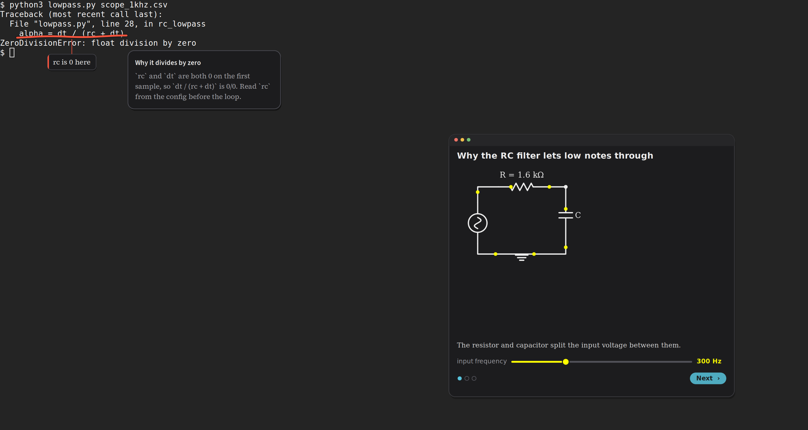

# screen-chalk

**Claude draws on your screen to explain it.** Ask about what's in front of you and Claude circles the button,
underlines the line that matters, arrows to the icon, and leaves a short note beside it, drawn by hand in an
overlay you click straight through. For "how does this work?" questions it can also put up a small animated
diagram you can poke (sliders, steps), in the spirit of 3Blue1Brown's Manim.



<sub>Drawn in a headless Sway by the commands in [Try it](#try-it-without-touching-your-session); the diagram is `bench/visual2/examples/rc-lowpass.json`.</sub>

The command is `chalk`. There are three ways to use it:

- **From Claude Code** (any session): the `chalk` MCP server gives Claude `screen_look`, `screen_draw` and
  `screen_clear`, so while it walks you through a GUI it can point instead of describing. This uses Claude Code's
  own login; nothing else is needed.
- **The hotkey**: Super+/ opens a prompt, you ask about the screen, and the marks draw themselves in ~3-5 s, with
  a diagram following for how/why questions. Follow-up questions build on what's already drawn; Super+Shift+/
  wipes it. This calls the model directly and needs an API key (see [Model access](#model-access)).
- **The CLI**: `chalk look`, `chalk draw '[...]'`, `chalk panel`, `chalk watch` and friends, for scripts and
  other tools. [Teach](https://github.com/aidenwboudr/teach), a one-to-one tutor for Claude Code, uses it for
  lessons that happen on your real screen (the tutor talks you through an app, marks where to click, and waits
  until you've done each step).

## Platform

chalk runs on **Sway** (Wayland) on Linux. It needs:

- **wlr-layer-shell** for the overlay (a click-through surface above every window, via gtk-layer-shell),
- **wlr-screencopy** for screenshots (`grim`, and chalk's own `chalk-cap` for following scrolled content),
- **Sway's IPC** (`swaymsg`) for the layout, outputs and windows: marks belong to the window they were drawn on
  and hide when its workspace isn't showing.

Other wlroots compositors (Hyprland, river, Wayfire, labwc) have the first two; what's missing there is the
window/output queries now done through `swaymsg`, which would need a small backend per compositor (Hyprland's
`hyprctl`, for example). GNOME and KDE don't offer layer-shell or screencopy to ordinary clients, so they'd need a
different overlay (a GNOME Shell extension, a KWin script) and the desktop portal for screenshots. X11 and macOS
would need their own overlay and capture code. Contributions for any of these are welcome; see CONTRIBUTING.md.

Tested on Ubuntu 24.04 and 26.04 with Sway 1.9-1.11.

## Install

On Ubuntu/Debian (other distros have the same packages under similar names):

```bash
sudo apt install sway grim python3-gi python3-gi-cairo gir1.2-gtk-3.0 gir1.2-gtklayershell-0.1 \
  gir1.2-pango-1.0 python3-numpy python3-pil
# optional, for the extras in the table below:
sudo apt install rofi wl-clipboard tesseract-ocr pulseaudio-utils nodejs npm gcc libwayland-dev libwayland-bin

git clone https://github.com/aidenwboudr/screen-chalk.git ~/.local/share/screen-chalk
~/.local/share/screen-chalk/install.sh --sway
```

For the MCP server and the hotkey you also need [Claude Code](https://docs.claude.com/en/docs/claude-code/setup)
(`curl -fsSL https://claude.ai/install.sh | bash`); install it first, or run `install.sh` again after.

`install.sh` (no sudo) links `chalk` and `chalk-mcp` into `~/.local/bin`, registers the MCP server with Claude
Code (`claude mcp add -s user chalk`, if `claude` is installed), and installs MathJax for diagram formulas (if npm
is there). `--sway` is for the machine whose screen chalk draws on: it builds `chalk-cap`, writes the hotkeys to
`~/.config/sway/config.d/chalk.conf` (checked with `sway -C` before Sway reloads), and starts the overlay. Your
Sway config must include that folder: `include ~/.config/sway/config.d/*` (the installer says so if it doesn't; with
no config of your own yet, start from a copy: `mkdir -p ~/.config/sway && cp /etc/sway/config ~/.config/sway/`).

| Needed for | Packages |
|---|---|
| everything (overlay, look, draw) | sway, grim, python3 with gi, GTK 3, gtk-layer-shell, PangoCairo, numpy, PIL |
| the hotkey's prompt | rofi (or pass the question: `chalk ask "what is this?"`) |
| marks that follow scrolling | gcc, libwayland-dev, libwayland-bin (`chalk-cap`); without it marks fade when the screen changes |
| typeset formulas in diagrams | node + npm (MathJax, `tex/`); without it formulas are plain text |
| Copy buttons on code cards | wl-clipboard |
| `chalk look --ocr`, marks placed by on-screen text | tesseract-ocr |
| `chalk say` out loud | a voice command and `pacat` (pulseaudio-utils, works with PipeWire); see [Voice](#voice) |

### Try it without touching your session

`bench/headless-sway.sh` starts a private headless Sway and prints the env to talk to it, so you can see chalk
work (and run the tests) on a machine where you don't want an overlay, or in a container:

```bash
cd ~/.local/share/screen-chalk
eval "$(bench/headless-sway.sh start)"
swaymsg exec foot           # something to draw on (any app; foot is a small terminal)
./chalk draw '[{"kind": "circle", "box": [40, 40, 300, 60], "label": "this"},
               {"kind": "card", "box": [40, 40, 300, 60], "title": "A note", "text": "Cards sit beside what they explain."}]'
grim /tmp/shot.png          # see it
bench/headless-sway.sh stop
```

## Using it

**Hotkeys** (what `install.sh --sway` binds):

| Key | Does |
|---|---|
| Super+/ | ask about the screen |
| Super+Shift+/ | wipe the drawing (and stop any voice); the next question starts fresh |
| Super+. | cards and diagrams that tucked themselves away (as tabs at the right edge) come back; again tucks them all |
| Super+; | give the newest panel the keyboard (1-9 pick, Enter next, typing fills its field; Esc gives it back) |
| Super+Ctrl+C | copy the newest panel's code (again: the next block) |

**From Claude Code**, just ask in a session: "where do I turn on dark mode in this app? show me". Claude calls
`screen_look`, then `screen_draw` with boxes in the screenshot's pixels.

**The CLI** (`chalk help`):

```
chalk look [--ocr] [--json]          screenshot (+ OCR'd text with ids) -> $CHALK_STATE/shot.png, look.json
chalk draw '<shapes json>' [--keep]  circle, box, underline, highlight, strike, arrow, point, label, path,
                                     spotlight, card, panel (place by box [x,y,w,h], at [x,y], OCR id or text)
chalk ask ["question"]               the hotkey's flow (rofi prompt without a question)
chalk panel '<spec>' --wait          a card the user answers (choices, typed answers, Done/Stuck, buttons, code
                                     with Copy); prints the answer as JSON (spec at the top of panel.py)
chalk watch [--timeout S]            wait until the screen changes and holds still, then look
chalk say "words" | hush             speak (or show as a toast without a voice) | stop speaking
chalk toast "words" | clear | peek | focus | copy | remove TAG | status | start | stop
chalk route teach <slug> "<title>" | off     send Super+/ questions to a Teach lesson's tutor
```

Shapes and scenes are documented where they're implemented: `overlay.py` (marks and cards), `panel.py` (panels),
`scene.py` and `scene.md` (diagrams), `policy.md` (what the hotkey's model is told about marking).

## Model access

- **The MCP server** runs inside Claude Code and uses whatever login Claude Code has. chalk makes no model calls
  for it.
- **`chalk ask` (the hotkey)** runs `claude -p --bare` (Claude Code's headless mode), and `--bare` authenticates
  only with **`ANTHROPIC_API_KEY`** (or an `apiKeyHelper` in Claude Code settings), never a subscription login.
  Put your own key where the hotkey sees it, e.g. in `~/.config/chalk/env`:
  `ANTHROPIC_API_KEY=sk-ant-...` (the file is yours alone: `chmod 600`). Give the key a spend limit in the
  Anthropic Console. chalk never sends your requests anywhere else: it doesn't read `ANTHROPIC_BASE_URL` or other
  settings unless you turn on `CHALK_CLAUDE_ENV_FROM_SETTINGS=1` (which copies the `ANTHROPIC_*` values from your
  `~/.claude/settings.json`, for setups that keep them there).
- Defaults: Opus at low effort for the marks (`CHALK_MODEL`, `CHALK_EFFORT`), a parallel call for the diagram
  (`CHALK_SKETCH=0` turns it off) and a check pass that fixes the diagram from a storyboard of its own frames
  (`CHALK_SCENE_CHECK=0`). Why these: `bench/README.md`.

**Privacy:** asking (the hotkey, or Claude Code's `screen_look`) sends a screenshot of your whole screen to the
model. chalk keeps its screenshots, the last look, the hotkey's conversation and `ask.log` (questions and answers)
in `$XDG_RUNTIME_DIR/chalk`, readable only by you and gone at logout.

## Settings

Settings are environment variables. `~/.config/chalk/env` (KEY=VALUE lines; another file with `CHALK_CONFIG`)
fills in whatever the environment doesn't set, so the hotkey, Claude Code's MCP server and your shell all agree.
`CHALK_CONFIG=/dev/null` runs with pure defaults (the tests do).

| Variable | Default | |
|---|---|---|
| `CHALK_MODEL`, `CHALK_EFFORT` | `opus`, `low` | the hotkey's model and effort |
| `CHALK_SKETCH`, `CHALK_SCENE_CHECK` | `1`, `1` | the diagram call, and its check pass |
| `CHALK_CLAUDE` | `claude` | the Claude Code command for `chalk ask` |
| `CHALK_CLAUDE_ENV_FROM_SETTINGS` | off | `1`: take `ANTHROPIC_*` from `~/.claude/settings.json` |
| `CHALK_STATE` | `$XDG_RUNTIME_DIR/chalk` | screenshots, looks, the conversation, `ask.log` |
| `CHALK_VOICE_CMD` | none | text on stdin -> 24 kHz mono s16le PCM on stdout (see Voice) |
| `CHALK_PLAYER` | `pacat --raw ...` | plays that PCM |
| `CHALK_HOST` | none | no Sway here: forward every command to this ssh host's chalk (see below) |
| `CHALK_VOICE_HOST` | none | ssh host whose `CHALK_VOICE_CMD` speaks for this machine |
| `CHALK_REMOTE_BIN` | `~/.local/bin/chalk` | chalk on the other machine |
| `CHALK_PYTHON` | `/usr/bin/python3` | the python with the GTK bindings, for the overlay |
| `CHALK_WATCH_IGNORE_TITLE` | `Teach$` | windows whose changes `chalk watch` ignores (regex on the title) |
| `CHALK_KEY_PEEK`, `CHALK_KEY_FOCUS`, `CHALK_KEY_COPY` | `Super+.`, `Super+;`, `Super+Ctrl+C` | the keys named in hints, if you bound others |
| `CHALK_TEACH` | `teach` | Teach's CLI, for `chalk route teach` |
| `CHALK_HOOKS` | none | a Python file with extra behaviour for the hotkey (API in `chalkconf.py`) |
| `CHALK_SCENE_THEME` | `dark` | diagram theme |

**Drawing on another machine's screen.** With `CHALK_HOST=mylaptop` on a machine that has no Sway session (a
server running Claude Code, say), every `chalk` command runs on `mylaptop` over ssh and screenshots come back, so a
remote Claude Code session can still look and draw. It needs key-based ssh to that host and chalk installed there.

**Hooks.** `CHALK_HOOKS=~/my-hooks.py` loads a module that can take a hotkey question somewhere else instead of
answering it (`intercept`), add background to the prompt (`context`), and add routes (`route_cmd`, `route`). The
signatures are in `chalkconf.py`.

### Voice

`chalk say` speaks through `CHALK_VOICE_CMD`, any command that reads text on stdin and writes raw 24 kHz mono
s16le PCM to stdout. `examples/kokoro_voice.py` is one, using the open Kokoro TTS model on the CPU (setup steps at
its top). Without a voice command, `say` shows the line as a small toast instead.

## How it works

| file | what |
|---|---|
| `overlay.py` | GTK3 + gtk-layer-shell overlay: one click-through surface per output, strokes animated like a pen, panels that take clicks. Listens on `$XDG_RUNTIME_DIR/chalk.sock`. |
| `chalk` | the CLI; `chalk-mcp` wraps it as an MCP server (stdio) |
| `ask.py` | the hotkey: screenshot, then two `claude -p` calls in parallel (marks streamed and drawn as they arrive, and a diagram) |
| `ground.py`, `layout.py` | boxes / OCR ids / on-screen text -> screen boxes; labels and cards placed over empty screen |
| `track.py`, `follow.py`, `cap/` | keeping the drawing in step with the screen: marks belong to their window, follow scrolled content (C helpers built by `cap/build.sh`), cards move out of the way or tuck into tabs |
| `panel.py` | panels you answer (spec at the top) |
| `scene.py`, `scene.md`, `scene-check.md`, `scenehost.py`, `tex/` | diagram boards: objects with expressions over sliders, steps and time; real TeX via MathJax; `scenehost.py` renders scenes for apps that show them in their own window (Teach) |
| `policy.md` | what the hotkey's model is told about marking |
| `bench/` | the benchmarks and tests that tuned it ([bench/README.md](bench/README.md)) |

## Tests

```bash
./test.sh                  # syntax + offline tests (no screen)
bench/test_watch.sh        # these start a private headless Sway (sway, foot, grim, jq, wtype, zenity, gcc)
bench/test_adapt.sh; bench/test_panel.sh; bench/test_scene.sh; bench/test_ask.sh
```

## License

MIT (see LICENSE). Bundled fonts and the Wayland protocol file keep their own licenses: THIRD_PARTY.md.
